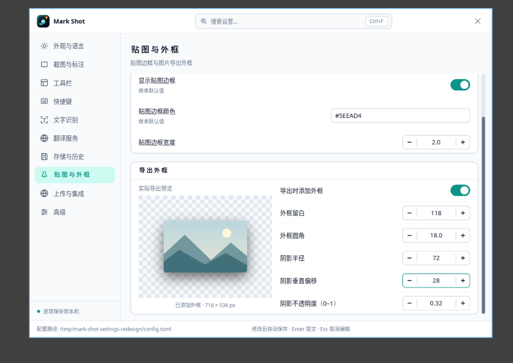

# 设置与标注改造记录

## 配置与交互

设置项由 `src/config/settings/` 注册类型、默认值、范围、候选值、分类、文案、检索词和生效提示。
默认值来自运行时配置结构，快捷键来自动作表，翻译服务字段来自共用目录。
`settings_store` 统一处理任意层级的 TOML / JSON 修改、浮点数、数组、恢复默认、兼容路径和原子写入。
首次运行只创建最小配置；完整模板保留为参考。已有文件中的显式值保持有效，避免覆盖用户自定义内容。

| 原审阅问题 | 实现结果 |
| --- | --- |
| 文本切页丢失、提交规则相反 | 离开字段、切页、关闭窗口统一提交；无效输入保留并显示原因，Esc 取消 |
| 配置损坏时无法打开设置 | 窗口显示恢复入口，修复前备份原文件，普通保存不会覆盖损坏文档 |
| 未设置值显示错误 | 显示有效默认值；兼容顶层语言；对环境变量、命令行覆盖提供说明 |
| 写入函数各自维护格式 | 通用设置、翻译、主题、历史、启动及 OCR 结果窗口写入统一存储入口 |
| 保存后丢失命令行参数 | 重新发布配置时保留启动参数覆盖，包括 `--nonotify` |
| 主题写入效果不同 | 两个入口共用旧模板颜色清理；支持浅色、深色和跟随系统 |
| 放大区有两个偏好来源 | 迁移旧工具状态到启动偏好；Shift+M 与设置窗口使用同一位置 |
| OCR 运行方式不一致 | 补齐启动时加载选项；CPU 自动设备支持常驻；系统引擎隐藏不适用选项 |
| 快捷键入口少且覆盖多组绑定 | 全部 59 个动作可编辑，支持追加、清除、恢复与冲突检查 |
| 完成动作组合不全 | 展示合法组合及空动作，不再把组合缩减为单一候选 |
| 翻译默认值与运行时不同 | 共用服务定义和解析规则；说明环境覆盖，密钥编辑显示长度和光标，错误随语言显示 |
| 搜索范围窄 | 搜索文案、说明、选项、分类与服务入口；结果显示所属页面 |
| 内容缺口 | 增加贴图、导出外框、上传、历史容量与目录、启动工具、OCR 结果窗口及日志路径等入口 |
| 页面与键盘规则不一致 | 共用外壳、下拉、输入框及导航；保留各页滚动位置，支持 Tab 与八边缩放 |
| OCR 资源入口分散 | OCR 设置显示本地状态并可打开资源管理窗口 |
| 测试依赖本机配置 | 设置测试使用临时文件；工具默认值与运行时保存入口在单元测试中隔离 |

内部绘制尺寸和算法参数继续采用启动配置；用户设置按照注册的生效阶段应用。
翻译服务和工具栏保留各自的业务状态，窗口外壳、导航、字段提交、配置保存和下拉组件共用。
系统主题订阅在设置窗口存活期间工作，Windows 同时响应平台主题通知。

## 工具栏与视觉

- 工具池排除已放入主栏和侧栏的工具，分隔线允许重复添加。
- 三个区域支持拖动，跨栏保存为同一事务，插入位置带避让动画；无效布局回滚。
- 选中工具显示快捷键配置以及移除操作，横纵排列、键盘排序和恢复默认均可使用。
- 主栏、侧栏和工具池使用同一组重绘 SVG，统一画布、描边和视觉尺寸。
- OCR 弹层突出当前语言，资源与其他语言折叠；光标放大区缩小并显示当前捕获内坐标。
- 设置顶栏使用应用正式图标，“高级”中的关于入口显示版本、功能说明与 GitHub 地址。

## 外框实际预览

预览使用正式导出渲染器；有效数值草稿立即更新图片，尚未确认的草稿不写配置。
关闭外框显示原图，启用后展示留白、圆角、阴影与最终像素尺寸。
数值控件采用紧凑步进按钮，宽窗口左右排列，窄窗口上下排列。

## 文字与形状

选择字体后弹层保持打开，焦点转到字号；确认字号保留正文会话，继续调整属性不会丢失编辑目标。
原版 Qt 的“确认字号立即提交正文”行为在本次改造中有意调整；回归测试按连续编辑规则验证。

矩形、方形标记、滤镜区域和矩形放大镜增加 `R` 圆角半径，单位为原图像素。
圆角参与屏幕绘制与导出，撤销恢复对象参数；工具状态保存半径和比例偏好。
圆形放大镜及非方形标记隐藏不适用的圆角控件。

矩形和椭圆增加 `1:1` 开关；按住 Shift 拖动临时约束为正方形或正圆，释放后恢复自由比例。
创建和属性编辑使用同一源图边界约束，固定比例的对象在后续调整大小时保持比例。

## 验证

- Rust 完整工作区：1,475 项通过，22 项需要外部环境的测试保持忽略。
- CPU 与 `ocr-gpu` 两种配置通过 Clippy，警告视为错误；Rust 格式检查通过。
- Python 验证工具：232 项通过，Ruff 导入检查通过。
- 独立 niri 会话验证 900×640、580×420、浅色与深色布局，外框预览使用真实窗口截图。
- 真实 Wayland 字体流程验证字体检索、选择后焦点、字号修改、正文连续编辑及 1600×900 原图导出。
- Linux / Windows 远程编译结果以本次提交对应的 GitHub Actions 记录为准。
